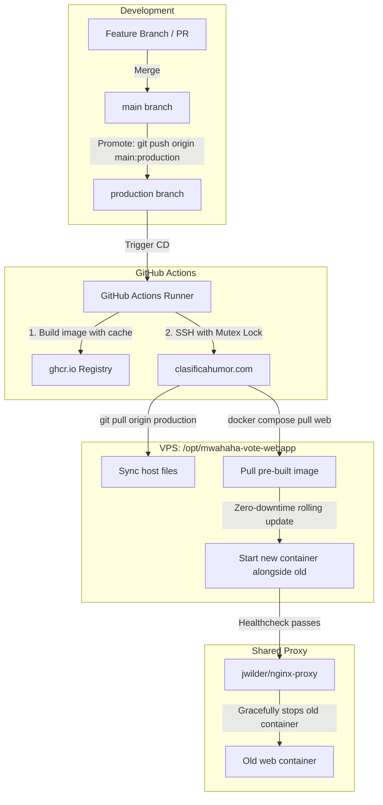
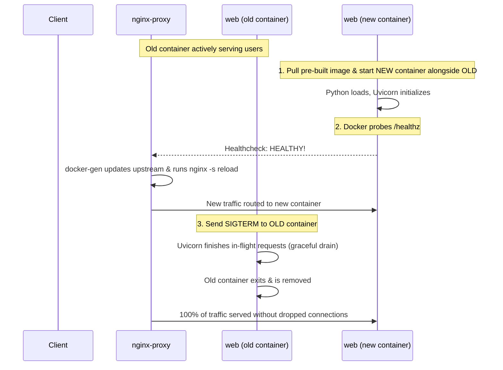

# Production Deployment & Zero-Downtime Architecture

This document describes the deployment architecture for **`mwahaha-vote-webapp`**, its shared infrastructure with **`clasificahumor`**, and the zero-downtime continuous deployment strategy.

---

## 1. Context & Production Environment

### Current Infrastructure

* **Host**: Single VPS (`santiago@clasificahumor.com`).
* **Shared Reverse Proxy & SSL**:
  * `jwilder/nginx-proxy` and `jrcs/letsencrypt-nginx-proxy-companion` running on the `clasificahumor_reverse_proxy_net` Docker network.
  * Dynamically discovers containers via `/var/run/docker.sock` and routes traffic for `VIRTUAL_HOST=thefunnier.com,www.thefunnier.com`.
* **Shared Database**:
  * MySQL 8.x container `clasificahumor-database-1` on the `clasificahumor_net` Docker network.
  * Houses both `pghumor` and `mwahaha` databases.
* **Background Scoring**:
  * An hourly ingestion and Elo computation loop runs directly on the host in an SSH `screen` session.
  * Outputs scores to `./web/scoring/` and `./web/src/mwahahavote/static/scores/`, which are volume-mounted into the `web` container.

### Bottlenecks in the Legacy Deploy Flow

Previously, deployments were performed via:
```bash
git push production
```
This triggered a `.git/hooks/post-update` hook on the server that ran `docker compose up -d --build`. This approach had significant issues:
1. **Severe VPS Resource Strain**: Compiling Python bytecode and resolving dependencies inside Docker on a budget VPS (1–2 vCPUs, 1–2 GB RAM) caused CPU spikes, memory starvation, and risks of OOM kills of the shared MySQL database.
2. **Downtime / 502 Bad Gateway**: The old container was stopped before the new container finished booting Uvicorn, creating a 3–8 second outage window for active users.
3. **No Image Versioning**: No registry images were stored; rollbacks required git force-pushes and full rebuilds.
4. **Concurrency Vulnerabilities**: Rapid pushes resulted in git index lock conflicts (`.git/index.lock: File exists`) and Docker container recreation collisions.

---

## 2. Target Architecture Overview



---

## 3. Branching & Deployment Strategy

To avoid deploying untested commits immediately on every merge to `main`, we separate integration from deployment using a dedicated **`production`** branch:

* **`main`**: Active development and PR integration branch.
* **`production`**: The deployed state running in production.

### Promoting to Production
When ready to ship updates to `thefunnier.com`:
```bash
# Push main to production branch
git push origin main:production
```
*(Alternatively, open a PR from `main` into `production` in GitHub and click Merge).*

---

## 4. Concurrency & Collision Prevention

If multiple deploys are triggered at the same time (e.g. quick back-to-back pushes), two guardrails prevent race conditions:

### Guardrail 1: GitHub Actions Concurrency Control
In `.github/workflows/deploy.yml`:
```yaml
concurrency:
  group: production-deploy
  cancel-in-progress: true
```
* **`cancel-in-progress: true`**: If a new push to `production` arrives while a previous build or deploy is running, the older job is cancelled immediately. The server only deploys the latest commit, saving runner minutes and bandwidth.

### Guardrail 2: Host-Side File Lock Mutex (`flock`)
On the server, wrap the deploy script with Linux `flock`:
```bash
flock -x /var/lock/mwahaha-deploy.lock -c "
  cd /opt/mwahaha-vote-webapp && \
  git pull origin production && \
  docker compose -f docker-compose.yml -f docker-compose.prod.yml pull web && \
  docker rollout web
"
```
* If another deploy process is active, any incoming execution safely waits for the lock to release rather than crashing with `.git/index.lock` errors or Docker container collisions.

---

## 5. Zero-Downtime Rolling Deployment Mechanics



### The 3 Pillars of Zero Downtime

#### 1. FastAPI `/healthz` Endpoint & Docker Healthcheck
In `web/src/mwahahavote/__main__.py`:
```python
@app.get("/healthz", include_in_schema=False)
async def healthz():
    return {"status": "ok"}
```

In `web/Dockerfile` or `docker-compose.yml`:
```yaml
healthcheck:
  test: ["CMD-SHELL", "python3 -c 'import urllib.request; urllib.request.urlopen(\"http://localhost:80/healthz\")' || exit 1"]
  interval: 3s
  timeout: 2s
  retries: 3
  start_period: 4s
```
* `nginx-proxy` monitors Docker container health status: **it will never add the new container to the Nginx upstream until its healthcheck reports `healthy`**.

#### 2. Graceful Shutdown in Uvicorn
In `web/Dockerfile`, the entrypoint uses `exec`:
```dockerfile
CMD ["sh", "-c", "exec uvicorn mwahahavote.__main__:app --host :: --port 80 --workers \"$(($(nproc) + 1))\""]
```
Because of `exec`, Uvicorn receives Docker's `SIGTERM` directly. It stops accepting new requests, drains all active in-flight requests within a grace period (default 30 seconds), and exits cleanly.

#### 3. Start-Before-Stop Orchestration (`docker-rollout`)
Rather than stopping the container before starting the new one, we start the new container alongside the old one.

The easiest and most reliable tool for Docker Compose is [`docker-rollout`](https://github.com/wowu/docker-rollout):
* **Installation on VPS** (one-time command):
  ```bash
  mkdir -p ~/.docker/cli-plugins
  curl -SL https://raw.githubusercontent.com/wowu/docker-rollout/master/docker-rollout -o ~/.docker/cli-plugins/docker-rollout
  chmod +x ~/.docker/cli-plugins/docker-rollout
  ```
* **Execution**:
  ```bash
  docker compose -f docker-compose.yml -f docker-compose.prod.yml pull web
  docker compose -f docker-compose.yml -f docker-compose.prod.yml rollout web
  ```

---

## 6. Implementation Configuration Files

### 1. `docker-compose.prod.yml`
Update the `web` service to use the pre-built GHCR image:
```yaml
services:
  web:
    image: ghcr.io/pln-fing-udelar/mwahaha-vote-webapp:production
    environment:
      - SENTRY_DSN
      - COMPETITION=haha
      - VIRTUAL_HOST=thefunnier.com,www.thefunnier.com
      - VIRTUAL_PATH=/
      - LETSENCRYPT_HOST=thefunnier.com,www.thefunnier.com
      - LETSENCRYPT_EMAIL=sacastro@fing.edu.uy
    volumes:
      - ./web/scoring/:/app/scoring
      - ./web/src/mwahahavote/static/scores:/app/src/mwahahavote/static/scores
    networks:
      - net
      - reverse_proxy_net
    restart: always

networks:
  net:
    name: clasificahumor_net
    external: true
  reverse_proxy_net:
    name: clasificahumor_reverse_proxy_net
    external: true
```

### 2. GitHub Actions Workflow (`.github/workflows/deploy.yml`)
```yaml
name: CD

on:
  push:
    branches:
      - production

concurrency:
  group: production-deploy
  cancel-in-progress: true

jobs:
  build-and-deploy:
    runs-on: ubuntu-latest
    permissions:
      contents: read
      packages: write
    steps:
      - name: Checkout code
        uses: actions/checkout@v7

      - name: Set up Docker Buildx
        uses: docker/setup-buildx-action@v3

      - name: Log in to GitHub Container Registry
        uses: docker/login-action@v3
        with:
          registry: ghcr.io
          username: ${{ github.actor }}
          password: ${{ secrets.GITHUB_TOKEN }}

      - name: Build and push Docker image
        uses: docker/build-push-action@v6
        with:
          context: ./web
          push: true
          tags: |
            ghcr.io/pln-fing-udelar/mwahaha-vote-webapp:production
            ghcr.io/pln-fing-udelar/mwahaha-vote-webapp:${{ github.sha }}
          cache-from: type=gha
          cache-to: type=gha,mode=max

      - name: Deploy to VPS over SSH
        uses: appleboy/ssh-action@v1.2.0
        with:
          host: clasificahumor.com
          username: santiago
          key: ${{ secrets.SSH_PRIVATE_KEY }}
          script: |
            flock -x /var/lock/mwahaha-deploy.lock -c "
              cd /opt/mwahaha-vote-webapp && \
              git pull origin production && \
              docker compose -f docker-compose.yml -f docker-compose.prod.yml pull web && \
              docker compose -f docker-compose.yml -f docker-compose.prod.yml rollout web
            "
```

### 3. Restricting the SSH Deploy Key on the Server
To ensure security, generate a dedicated SSH key pair for GitHub Actions and lock it down in `~/.ssh/authorized_keys` so it can only execute the deployment command:
```text
command="flock -x /var/lock/mwahaha-deploy.lock -c \"cd /opt/mwahaha-vote-webapp && git pull origin production && docker compose -f docker-compose.yml -f docker-compose.prod.yml pull web && docker compose -f docker-compose.yml -f docker-compose.prod.yml rollout web\"" ssh-ed25519 AAAAC3... github-actions-deploy-key
```

---

## 7. Hourly Scoring Loop Modernization (Optional Quick Win)

Currently, the hourly ingestion and scoring pipeline runs in an interactive `screen` session:
```bash
while true; do ... sleep 3600; done
```
To ensure this survives reboots and logs cleanly, configure a **systemd service and timer**:

### `/etc/systemd/system/mwahaha-scoring.service`
```ini
[Unit]
Description=MWAHAHA Ingestion and Scoring Pipeline
After=docker.service
Requires=docker.service

[Service]
Type=oneshot
User=santiago
WorkingDirectory=/opt/mwahaha-vote-webapp/web
EnvironmentFile=/opt/mwahaha-vote-webapp/.env
ExecStart=/bin/bash -c 'export DB_HOST=$(docker container inspect clasificahumor-database-1 | uv run jq -r ".[0].NetworkSettings.Networks.\"clasificahumor_net\".IPAddress"); ./scripts/ingest_submissions.py && ./scripts/compute_scores.sh'

[Install]
WantedBy=multi-user.target
```

### `/etc/systemd/system/mwahaha-scoring.timer`
```ini
[Unit]
Description=Run MWAHAHA Ingestion and Scoring hourly

[Timer]
OnBootSec=5min
OnUnitActiveSec=1h
Persistent=true

[Install]
Timers.target
```

Enable and start with:
```bash
sudo systemctl daemon-reload
sudo systemctl enable --now mwahaha-scoring.timer
```
Inspect logs at any time using:
```bash
journalctl -u mwahaha-scoring.service -n 50 -f
```
